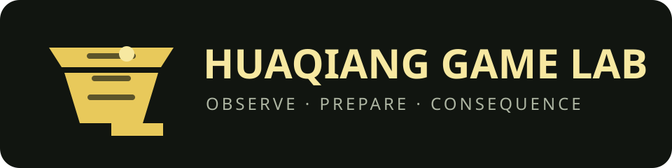
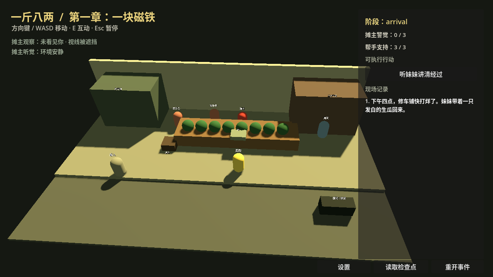

# Huaqiang Game Lab

[English](README.md) · [简体中文](README.zh-CN.md)

**《一斤八两》 is a third-person social-stealth prototype about winning the encounter before it starts.** Set in 铁衡市, a fictional late-1990s Chinese industrial city, it asks you to read the room, move the furniture, test the people, and make the witnesses tell your version of the story.

> **Observe. Prepare. Consequence.** A small game-design lab testing whether observation, social pressure, spatial preparation, and an escape plan can carry a tense scene without a conventional combat loop.

> **Status: paused indefinitely (2026-09-29).** This is an exploratory Phase 4 engineering candidate, not a finished game or an active production.



*The Godot 4.7.1 vertical slice in its current greybox state.*

## Quick start

The browser greybox needs Node.js and Python 3; the rules prototype needs Python 3. Neither needs a build step.

```bash
# Browser greybox: interaction, state changes, and event log
cd 一斤八两/greybox
npm test
npm start
# Open http://localhost:4173
```

```bash
# Python rules prototype: facts, witnesses, space, conflict, narrative
cd 一斤八两/prototype
python -m unittest discover -s tests -v
python play.py
```

For the 3D slice, install **Godot 4.7.1 stable**, then:

```bash
export GODOT_BIN=/path/to/Godot_v4.7.1-stable_linux.x86_64
cd 一斤八两/vertical_slice
bash tools/run_godot.sh
bash tools/test_godot.sh
```

`WASD` / arrow keys move, the mouse rotates the camera, `E` performs the nearest valid interaction, and `Esc` pauses and releases the mouse. Capture and Linux export scripts are documented in the [vertical slice guide](一斤八两/vertical_slice/README.md).

## What it can do now

- **Three complete routes through the first chapter:** public pressure, prepared withdrawal, and an unprepared injured escape. Each ends with neighbourhood and police versions of the event, plus a next-chapter hook.
- **Keep facts and stories separate:** the system tracks what happened, what witnesses know, and what the street and authorities believe happened.
- **Make perception explainable:** distance, view angle, physical occlusion, and sound decide whether an action is seen or heard — and the UI says why.
- **Make space a resource:** moving a stool, choosing a position, or arranging a getaway changes the available outcomes.
- **Hold a real slice together:** third-person movement, collision, context actions, checkpoints, settings and accessibility options, procedural audio, automated tests, and rendered captures.
- **Validate in three layers:** a Python rules model, a browser greybox, and a Godot 3D slice expose assumptions before art and content get expensive.

## Architecture

The repository is deliberately layered: each layer validates a different risk before the next one costs more.

| Layer | Path | What it proves |
| --- | --- | --- |
| Rules prototype | `一斤八两/prototype/` | Facts, witnesses, spatial preparation, conflict outcomes, and the two public versions of an event. |
| Browser greybox | `一斤八两/greybox/` | Step-by-step interaction and readable NPC reactions with no build step. |
| Godot slice | `一斤八两/vertical_slice/` | Third-person movement, perception, sound, conflict, checkpoints, settings, and rendered evidence. |
| Design record | `一斤八两/docs/` | Phase gates, decisions, risks, the originality/IP boundary, and the split development plan. |
| Idea book | `ideas/` | Four adjacent concepts built from the same street-market premise. |
| Process reference | `game_dev_flow.md` | The working reference for the project's gated game-development process. |

The main design source is indexed at [`一斤八两/docs/designs/`](一斤八两/docs/designs/); current gates and evidence live in [`一斤八两/docs/`](一斤八两/docs/).

## How to develop

- **Rules prototype:** `cd 一斤八两/prototype && python -m unittest discover -s tests -v`
- **Browser greybox:** `cd 一斤八两/greybox && npm test`
- **Godot slice:** set `GODOT_BIN`, then `cd 一斤八两/vertical_slice && bash tools/test_godot.sh`
- **Document checks:** `bash 一斤八两/tools/validate_phase0.sh` and `bash 一斤八两/tools/validate_phase1.sh`
- **Before committing:** keep generated state, local caches, exports, and secrets out of the tree; `.gitignore` already covers the main cases.

The greybox is plain HTML, CSS, and ES modules. The prototype is plain Python. The slice is a Godot project with its own run, test, capture, and export scripts.

## How to contribute

Start with [`CONTRIBUTING.md`](CONTRIBUTING.md), then read the [game-specific contribution rules](一斤八两/CONTRIBUTING.md) before changing the main project. Keep changes small and evidence-backed, preserve the existing phase gates, and do not add unlicensed media or material derived from protected source works.

Good contributions include reproducible tests, documentation fixes, accessible UI improvements, small rules experiments, and clearly labelled design evidence. For a PR, state which gate the change affects and include the smallest relevant test or capture. For a docs change, say what you checked.

## Roadmap

### Implemented

- [x] Phase 0 repository and concept checks.
- [x] Phase 1–3: concept, Python rules prototype, browser greybox, and engine decision, all passed as **Conditional Go**.
- [x] Phase 4 engineering candidate: a Godot 4.7.1 vertical slice with the first chapter's full flow.
- [x] Three routes from opening to result: public pressure, prepared withdrawal, and unprepared injured escape.
- [x] Perception, sound, conflict, checkpoints, settings, procedural audio, automated tests, and rendered evidence.
- [x] Splittable design plan, decision register, risk register, and originality/IP record.

### Planned — currently paused

- [ ] Owner acceptance of all three routes: duration, clarity, replay desire, and whether the greybox visual/audio direction represents the intended game.
- [ ] Slice refinement, limited to findings from that acceptance.
- [ ] A production decision: scope a small complete game only if the slice earns it; otherwise shrink, redirect, or stop.

Owner acceptance is the next gate. It has not been completed, so Phase 5 has not started.

## Future vision

If the slice earns it, the target is an offline, single-player PC game set in dense semi-open neighbourhoods, where preparation and social pressure matter more than a combo meter. That is a direction for the work, not a release date or a promise of production approval.

## Project records

- [Development plan index](一斤八两/docs/designs/README.md)
- [Project charter](一斤八两/docs/project-charter.md)
- [Originality and IP boundary](一斤八两/docs/originality-and-ip.md)
- [Risk register](一斤八两/docs/risk-register.md)
- [Decision register](一斤八两/docs/decision-register.md)
- [Phase 4 progress](一斤八两/docs/phase-4-progress.md)
- [Changelog](CHANGELOG.md)

## Caveats

This is unfinished. Art, animation, voice, audio, and camera are not final quality. Godot is validated on Linux with 4.7.1; other platforms are unverified. Automated tests validate rules and technical paths, not fun, market demand, accessibility completeness, or owner acceptance.

Do not infer financing, authorization, external playtesting, a release date, or production approval from this repository.

## License

Unless a nested artifact states otherwise, this collection is licensed under the [GNU Affero General Public License v3.0 only](LICENSE).
